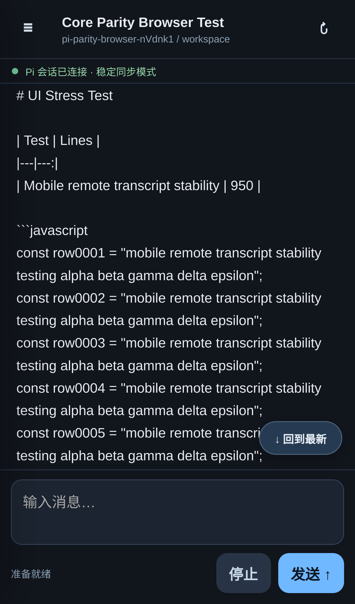
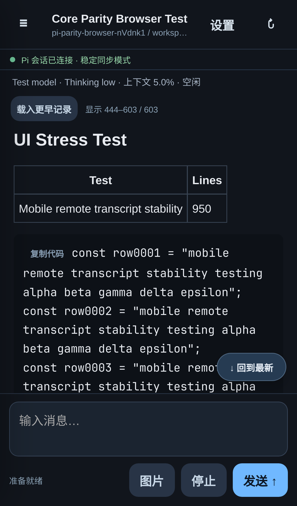

# PWA core parity milestone (Issue #41)

Development branch: `feature/pwa-core-parity`; PR base: `feature/pwa-mobile-ux`.
This milestone is **not deployed**. Existing stable/UX gateways, native Tailcat,
T3 Code, systemd units and HTTPS routing were not changed.

## Implemented vertical slices

- **A — Rich transcript:** local Marked + DOMPurify + highlight.js; headings,
  lists, tables, fenced code, protocol-restricted links, exact code copying;
  escaped raw HTML; lazy KaTeX MathML for `\(...\)` and `$$...$$` outside code.
  Thinking is independently collapsed by default. Tool calls/results are ordered,
  collapsed and correlated by tool-call ID; running tools expose bounded partial
  progress. Expansion state and unchanged message DOM survive polling.
- **B — Sessions/models:** create PWA-owned sessions through native `new_session`,
  rename through `set_session_name`, select configured models and supported
  thinking levels, display current model/context usage/running status. Only
  `get_commands`-advertised extension/template/skill slash commands are accepted;
  no arbitrary shell endpoint or TUI-only command emulation. Generation, RPC
  session identity and late-response checks protect against stale session writes.
- **C — Interaction/images:** confirm/input/select/editor dialogs require explicit
  user answers; reject, cancel and native timeout semantics are preserved. No
  auto-approval. Image picker supports preview/removal and authenticated native
  RPC `ImageContent`; PNG/JPEG/WebP/GIF, at most 3 images, 2 MiB each, 9 MiB total
  HTTP request. Server checks MIME signatures and canonical base64; unsupported
  visual models and malformed/oversize input are rejected before dispatch.
- **D — History/reliability:** latest 160 messages by default; load older in
  80-message pages with scroll anchors and a bounded 320-message reading window.
  "回到最新" restores the newest window. Versioned history cursors reject stale
  pages. State ETags return 304 for unchanged snapshots. iOS remains in polling
  mode; SSE fallback, retry, foreground recovery and command reconciliation remain.
  Shell cache and recovery redirect consistently use **v8.3**.

All mutating controls and image prompts have durable command receipts. Receipt
files store hashes/metadata, not prompt text, images or UI answers. Public model
metadata excludes provider headers, endpoint URLs and credentials. Dialog records
and tool progress are bounded. Suspended browsers do not control the lifetime of
Pi tasks, and waiting dialogs are not evicted as idle sessions.

## Storage and API configuration

This branch no longer implicitly opens native `~/.pi/agent/sessions`. Default
owned storage is `<PWA state dir>/sessions`; default workspace is
`<PWA state dir>/workspace`. Empty Pi sessions are not flushed by Pi until the
first assistant message, so a private ownership manifest retains their identity,
name/model/thinking and immutable generation across reopening.

Host configuration may set `PI_CODING_AGENT_SESSION_DIR` to a **dedicated owned
session root**, and `PI_REMOTE_PWA_WORKSPACES` to a JSON array of existing trusted
workspace directories. Clients choose opaque workspace IDs; they cannot submit
arbitrary cwd/session paths. Use a distinct state directory, cookie name and HTTPS
origin for any later deployment. Never reuse the currently running gateway's
session directory or unit as a deployment shortcut.

New/extended authenticated APIs:

- `GET /api/workspaces`: allowlisted workspace IDs/names.
- `POST /api/sessions`: `{workspaceId, commandId}`; creates/deduplicates a session.
- `GET /api/sessions/:id/controls`: filtered models, thinking levels, discoverable
  commands and context/session statistics.
- Existing `POST .../commands`: additionally accepts native rename/model/thinking
  controls, explicit `extension_ui_response`, and prompt images. Controls require
  the selected immutable `generation` and a durable `commandId`.
- Existing `GET .../state`: includes structured live content, tools, UI requests,
  context usage and bounded history metadata. Optional `limit` (1–200), `before`
  and `revision`; supports `If-None-Match` after authentication.
- Existing `GET /api/commands/:id`: creation receipts include the public session
  descriptor, allowing a lost creation response to be reconciled.

No generic file-management, credential or shell API was introduced.

## Validation completed on Omarchy

- `npm run test:pwa`: **59/59** passing, including security, streamed Thinking/tool
  reconstruction, image boundaries, repeated mutations, history paging/ETags,
  stale model response races, HTTP retry/304 recovery and worker/recovery behavior.
- `npm run check`: Host **34/34**, Relay **15/15**, both TypeScript checks passed.
- `npm run build:control-plane`, static JavaScript validation and `git diff --check`
  passed. Local vendor build is reproducible; production dependency audit: **0**
  known vulnerabilities at validation time. CI installs the locked dependencies
  and verifies bundled assets; no CDN runtime dependency.
- Installed **Pi 1.0.4** real RPC: create, rename, switch configured model and back,
  reopen empty session, real provider prompt, two real bash tools, real Thinking,
  deduplicated prompt and persisted-history reopen passed.
- Real extension: all four dialog methods, explicit rejection/cancellation,
  duplicate-answer receipts and native timeout passed. Extension was loaded only
  in temporary test children, never installed globally.
- Real visual model received the PNG test image and correctly identified red;
  repeated image command produced one user message.
- Real long Markdown/JavaScript output: **16,236 output tokens**, **88,470 text
  characters**, stream observed, 950 required lines and final marker present;
  completed in about **135 seconds**.
- Detached task: a real bash sleep/marker command completed while there were no
  browser/SSE/state requests for **20 seconds**; one prompt, task idle at cleanup.
- Linux WebKit with iPhone 13 profile: 603-message fixture using that real long
  assistant response; rich rendering, exact long-code clipboard hook, settings,
  explicit interaction rejection, image preview/removal, older-history scroll
  anchors, 320-node bound, transient 503 recovery, reopen and v8.3 recovery passed.
  Width was **390/390 px**, composer stayed within a simulated **430 px** viewport.
  No application page/console errors. Playwright's screenshot helper alone
  produces a CSP style warning; production CSP was deliberately preserved.
- Chromium bounded sample: 12 unchanged sync responses were **304**, **0** transcript
  DOM mutations; GC-normalized heap **3,856,032 → 3,956,000 bytes** (about **+100 KB**);
  scroll frame median **16.7 ms**, p95 **16.8 ms**. This short host sample does not
  establish indefinite memory stability or actual iPhone performance.

The before/after images below use the same generated test conversation in **host
WebKit mobile emulation**. They are **not physical iPhone screenshots**. Neither
existing deployed gateway was used to capture them.

| UX baseline | Core parity |
|---|---|
|  |  |

## Limits and required physical-device acceptance

- No new deployment or HTTPS origin was created by this development task. Actual
  iPhone testing requires a later explicitly authorized isolated deployment.
- Await physical iPhone Safari/Home Screen tests: keyboard/composer, actual system
  clipboard, gallery permissions/MIME handling, answering/cancelling all dialogs,
  long-text scrolling and sustained memory, lock screen 5–10 minutes, Safari
  background, force-close/reopen, Wi-Fi/cellular switching and command recovery.
- Syntax highlighting is bounded to 32 KiB per code block; larger blocks retain
  complete selectable/copyable source without expensive automatic highlighting.
- History pages are normally capped at 1 MiB; one message may be up to 2 MiB.
  Larger individual messages fail explicitly rather than allocating an unbounded
  browser payload. Tool output starts at 8,000 characters with "show more" and
  exact full-content copy. History currently covers the active RPC conversation;
  pre-compaction/abandoned branches are not a session-tree browser.
- Full `get_messages` still runs locally inside the host. Paging/ETags reduce
  HTTPS transfer and browser churn, not host-side RPC snapshot cost. Measure
  genuinely huge histories before adding more protocol complexity.
- Installed extensions can override the model on a subsequent prompt; the UI
  reports the authoritative Pi model rather than promising a provider override.
- API acceptance of a dialog response means it was written once to native stdin;
  Pi emits no ordinary response acknowledgement for extension UI answers.
